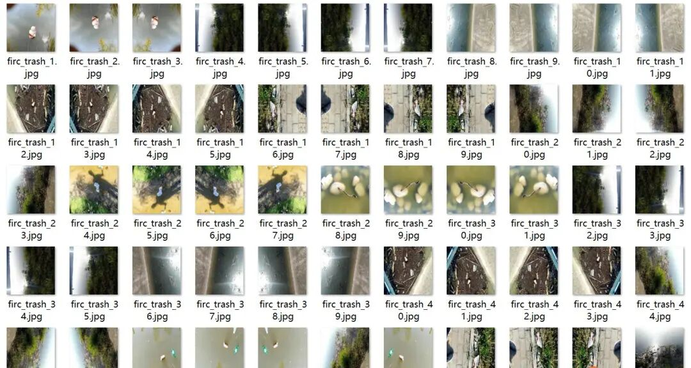
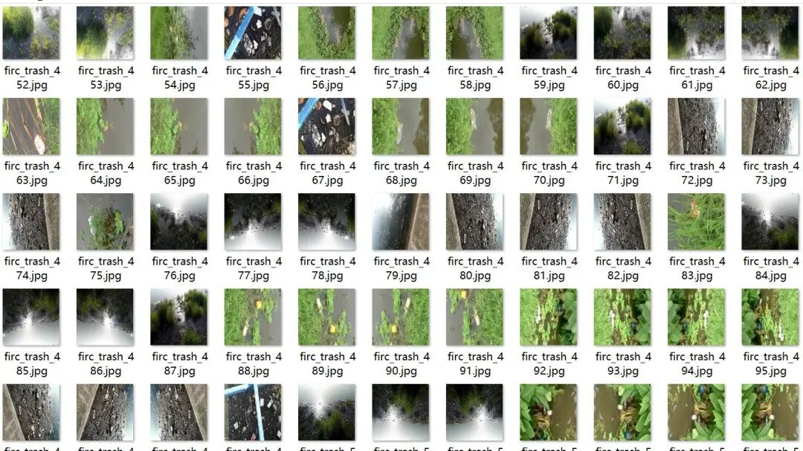
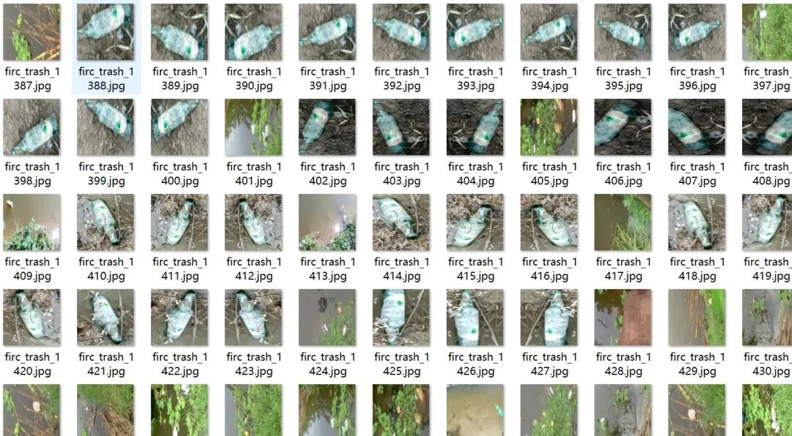
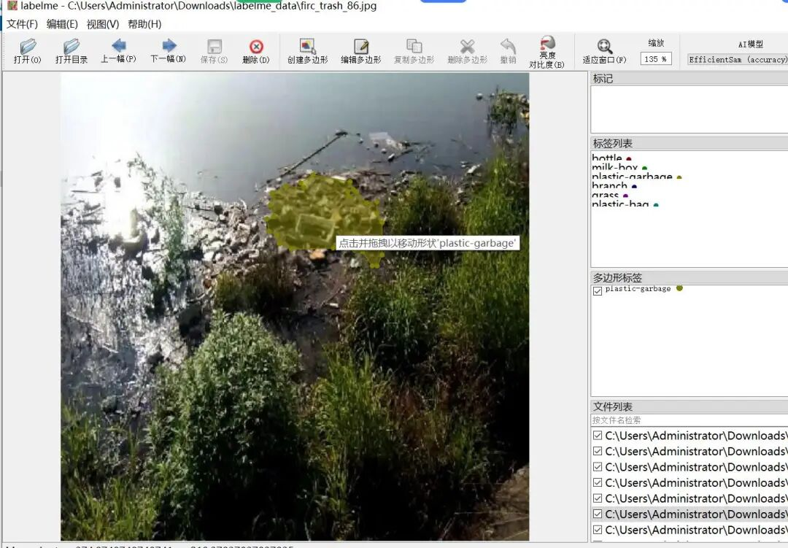
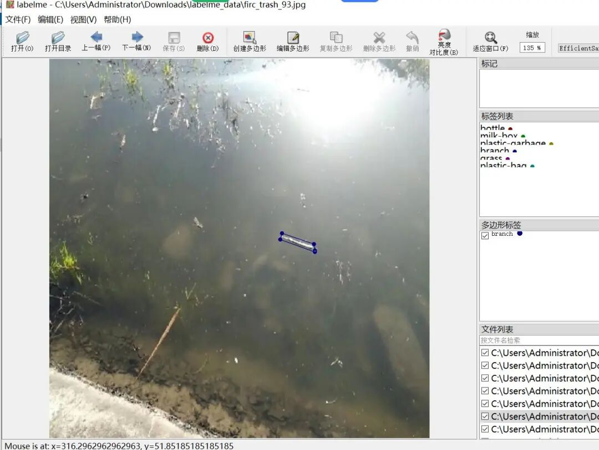
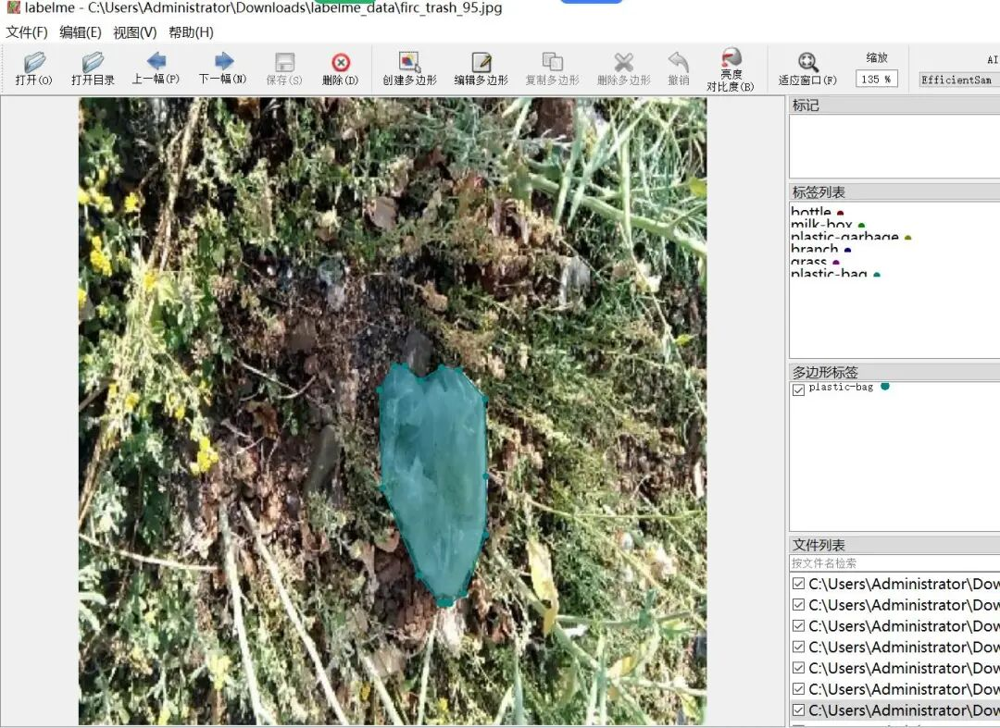

# Water Surface Garbage Identification and Segmentation Dataset - LabelMe format with 2111 images in 8 categories

Some of the images in the dataset have been enhanced, please note that to provide model generalization recognition capabilities, a very small portion of them are not water surface trash.

Some enhanced images are included in the dataset. Please note that to enhance the model's generalization ability, a very small number of them are not water-based waste. For specific details, please refer to the images.

Dataset format: labelme format (without mask files, only including jpg images and corresponding json files)

Number of images (number of jpg files): 2111

Number of annotations (json file count): 2111

Annotation Category Count: 8

Label category names: ["bottle", "branch", "plastic-garbage", "plastic-bag", "leaf", "grass", "milk-box", "ball"]

Number of boxes labeled in each category:

bottle count = 1733

branch count = 314

plastic-garbage count = 250

plastic-bag count = 302

leaf count = 191

grass count = 275

milk-box count = 307

ball count = 83

Using labeling tool: labelme=5.5.0

Annotation rules: Draw polygons around the categories.

Important Notice: The dataset can be opened and edited using LabelMe. For JSON datasets, one must convert them into mask or Yolo formats for semantic segmentation or instance segmentation.

Special : This dataset does not guarantee the accuracy or precision of the trained models or weight files. The dataset is provided with accurate and reasonable annotations only.

Image Preview:

Annotation example:

## Payment

Here is a pay link on Stripe ( https://buy.stripe.com/3cs8yP7sY87d0vu9AB ). Please contact me lonlonago@foxmail.com after funding $89, and I will send you a complete data files , thank you!

